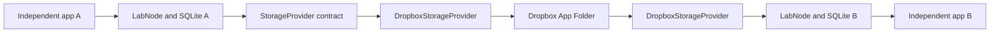

# Transport architecture and feasibility assessment

Research date: October 18, 2026 (America/Vancouver). This is a benign transport
prototype and a documentation assessment, not a deployed Mythic integration.

## Architecture and decisions

Both endpoints send and receive; arrows above illustrate one direction. SDK calls
are confined to the Dropbox adapter and setup/credential code. `LabNode` knows only
the storage interface. `lab_app.py` composes the selected implementation. The
older version-1 text format remains supported by `message_cli.py`; lab applications
use a separate strict version-2 heartbeat/ack schema and filename prefix, so they
do not consume old text messages.

The v2 schema contains exactly `version`, `run_id`, `message_id`, `timestamp`,
`sender`, `recipient`, `kind`, and `correlation_id`. Version is 2; kind is only
heartbeat or ack; no arbitrary processing payload is accepted. Run/IDs are UUIDs,
routes are node-a/node-b, and timestamps use UTC. An acknowledgement has a
deterministic ID derived from its heartbeat and retains the heartbeat timestamp;
that field is correlation metadata, not receipt creation time. Actual processing
and receipt observation times are in local SQLite events.

Each sender persists its outbox before upload. A receiver commits its processing
record and acknowledgement outbox together, then uploads the acknowledgement.
Stable filenames and identical retry bytes recover from an ambiguous upload.
Receipts are correlated against the exact original envelope. States are pending,
sent, and acknowledged. Restarts preserve UUIDs and queued work. Files remain
available for replay, so polling will repeatedly observe already handled IDs.

There is no distributed lock or shared deduplication database. With two gateway
replicas, processing occurs at most once per retained local database, but can
occur on both replicas. Reports distinguish repeated observation from repeated
processing across databases. Exactly-once external effects would require an
idempotent destination or shared transaction/coordinator, outside this prototype.
Deleting state loses deduplication knowledge. Deleting cloud files can prevent a
fresh worker from recovering old traffic; neither deletion is performed by the lab.

The folder/account is the trust boundary. UUID validation and byte hashes detect
accidental mismatches; they do not authenticate an independent sender. A party
with write access to the folder can forge envelopes. No end-to-end signatures,
encryption layer, adversarial replay protection, or multi-tenant isolation is
claimed. The implementation is for harmless traffic in a controlled lab. Downloads
are SDK-buffered before schema size validation, and full folder scans are deliberately
simple; larger deployments would need bounded streaming and incremental listings.

Dropbox's OAuth guidance describes refresh tokens for background access. The SDK
obtains replacement short-lived tokens; an invalid/revoked refresh credential
requires renewed consent. Local use retains the existing OS credential store;
gateway services use systemd-managed credentials. See the [Dropbox OAuth guide](https://docs.dropboxapi.com/dropbox-api/docs/oauth).

## Mythic profile and agent boundaries

The official C2 profile documentation distinguishes profile metadata/configuration
from the separately running communications program. Profiles connect a particular
communications format with the backend, while supported payload types declare
compatibility with that profile. This is an architectural boundary, not evidence
that a generic file exchange implements Mythic's message protocol. See [profile
definition documentation](https://docs.mythic-c2.net/customizing/c2-related-development/mythic-definition/2.1.1-c2-class-definition).

The Python SDK's `C2Profile` definition exposes metadata, parameters, server
paths, validation and sample-message hooks, custom RPC hooks, and a container-start
hook. These concern registration and lifecycle; they do not make our heartbeat
JSON a supported agent message. See the inspected [C2ProfileBase source](https://github.com/MythicMeta/MythicContainerPyPi/blob/main/mythic_container/C2ProfileBase.py).

The inspected service implementation discovers subclasses, initializes shared
services, registers profile lifecycle handlers, and synchronizes profile definitions.
Its lifecycle/control communication uses RabbitMQ. Profile registration and
communications-process start/stop are distinct responsibilities. See the [service
lifecycle source](https://github.com/MythicMeta/MythicContainerPyPi/blob/main/mythic_container/mythic_service.py).

The inspected moving `main` branch declares PyPI version `0.6.16` and container
protocol version `v1.4.3`. These are observations of source at research time, not
a release pin or a tested compatibility claim. See [SDK version declarations](https://github.com/MythicMeta/MythicContainerPyPi/blob/main/mythic_container/__init__.py).

| Concern | Current prototype | Remaining research/engineering |
| --- | --- | --- |
| Storage transport | Byte storage with a Dropbox adapter | Retain behind the interface; validate cloud constraints against chosen deployment |
| Profile registration | Absent | Pin a Mythic/SDK revision and assess lifecycle/configuration compatibility |
| Agent wire semantics | Only fixed lab heartbeats/acks | Separate schema/identity/crypto compatibility assessment; no interoperability established |
| Backend protocol | Absent | Evaluate documented backend boundary with synthetic fixtures only |
| Agent behaviour | No execution or task dispatch | Separate responsibility, not part of storage or this experiment |
| Redundancy | Local dedup plus measured replica duplicates | Decide coordination and idempotency requirements before any external effects |

Assessment: the storage abstraction is reusable as a component in principle;
direct Mythic compatibility has not been implemented or demonstrated. Packaging,
version pinning, lifecycle semantics, identity boundaries, protocol validation,
and end-to-end compatibility tests remain. The project installs no Mythic SDK and
does not create a C2 profile, route agent traffic, or issue operational tasking.

## Dropbox versus OneDrive

The provider replacement keeps `LabNode`, v2 envelopes, durable states, and tests
unchanged. It requires a new `OneDriveStorageProvider` plus credential/composition
configuration; that adapter is not implemented here.

| Concern | Dropbox implementation | OneDrive work required |
| --- | --- | --- |
| Identity and root | Dropbox app key, OAuth refresh credential, App Folder | Entra app/consent and target drive's app folder; both peers must reach the same drive |
| Put/get/delete | SDK file methods | Graph upload/download/delete mappings and safe response disposal |
| Enumeration | SDK continuation cursor | Follow Graph continuation links and filter file items |
| Conflicts | Explicit create-only or overwrite | Preserve that contract, including ambiguous-create handling; verify conditional semantics |
| Throttling | SDK rate-limit backoff and bounded adapter attempts | Map Graph 429/Retry-After and transient errors to StorageError |
| Observability | Adapter attempt counts, RTT and completion rates | Keep the same metric definitions and rerun the same experiments |

Microsoft documents `Files.ReadWrite.AppFolder` and `special/approot`, including
delegated and application-only access patterns; application-only calls use an
explicit drive rather than `/me`. Validate intended tenant policy and consent
before selecting a credential flow. See [app folder documentation](https://learn.microsoft.com/en-us/graph/onedrive-sharepoint-appfolder).

Graph provides content upload/replacement, content download, child enumeration,
and deletion endpoints. Download may redirect to a temporary preauthenticated URL;
the adapter must not log those URLs. See [upload](https://learn.microsoft.com/en-us/graph/api/driveitem-put-content?view=graph-rest-1.0),
[download](https://learn.microsoft.com/en-us/graph/api/driveitem-get-content?view=graph-rest-1.0),
[listing](https://learn.microsoft.com/en-us/graph/api/driveitem-list-children?view=graph-rest-1.0),
and [deletion](https://learn.microsoft.com/en-us/graph/api/driveitem-delete?view=graph-rest-1.0).

Graph throttling guidance calls for respecting Retry-After and avoiding aggressive
polling; SDK retries must be accounted for when bounding total attempts. See
[Microsoft throttling guidance](https://learn.microsoft.com/en-us/graph/throttling).

No OneDrive latency or error-rate measurements were made. A fair comparison needs
the same message counts, poll intervals, outage scenarios, machine resources, and
credential/drive topology, with repeated runs and recorded dependency versions.
